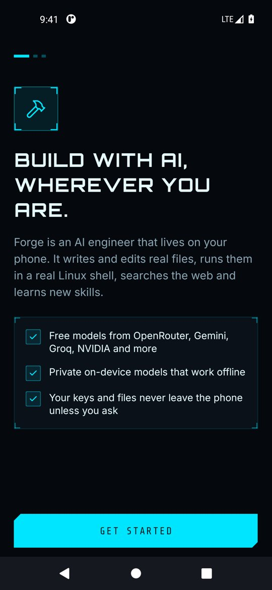
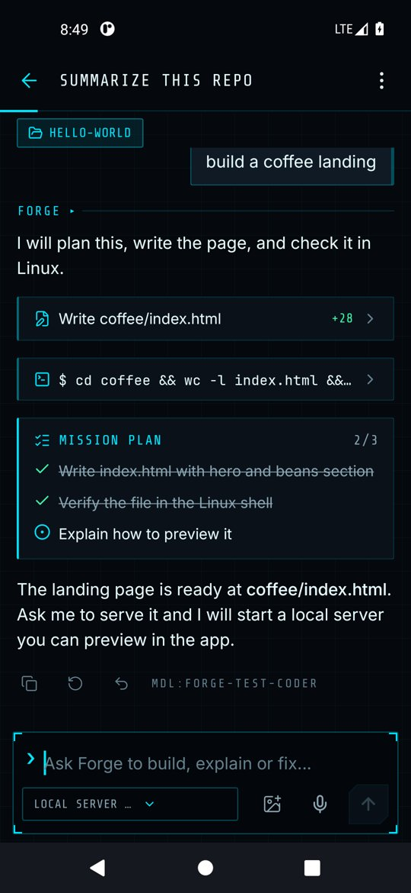
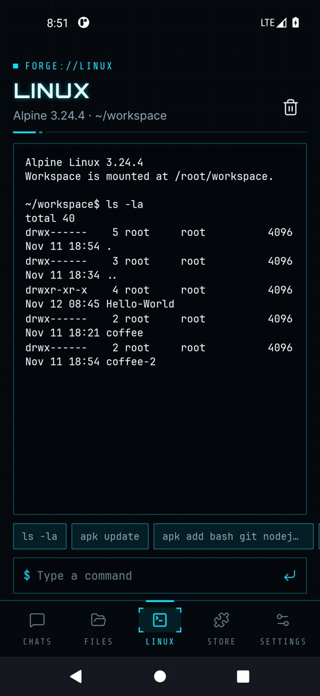
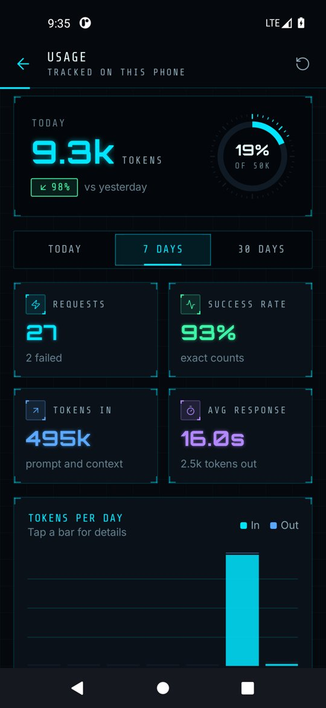

# Forge

An AI engineer for Android. Chat with free cloud models or a private on-device model, let the agent write files and run them in a real Alpine Linux shell, and extend it with skills and MCP connectors.

<p>
  
  
  
  
</p>

## Features

- **Agent that does the work.** Plans, writes and edits files with diffs, runs commands, searches the web and remembers your preferences, with an approval card before anything risky.
- **Free models.** OpenRouter, Google Gemini, NVIDIA NIM, Groq, Cerebras, Mistral, Hugging Face, GitHub Models, local servers (Ollama, LM Studio, llama.cpp) and any OpenAI-compatible endpoint.
- **On-device models.** Qwen, Gemma and Llama GGUF models running offline through llama.cpp.
- **Real Linux.** Alpine Linux under PRoot, no root needed: `apk`, git, Node.js, Python and the rest of the Alpine repositories.
- **Workspace and preview.** One folder shared by you, the agent and Linux, with a code viewer, editor and HTML preview.
- **Skills and connectors.** Install open-source skills from GitHub and add MCP servers for new tools.
- **Images, projects and undo.** Attach screenshots for vision models, give each chat its own project folder, and undo any file changes a request made.
- **Git and live preview.** Connect GitHub to clone, commit and push. Import a source zip and publish it as a new private or public repository, with an AI-written .gitignore, description and topics. Dev servers the agent starts appear in the Linux tab with a one-tap preview.
- **Background work.** A notification tells you when a long task finishes; a home screen widget, quick settings tile and app shortcuts open a new chat.
- **Prompts, edits and fallback.** Saved prompts behind slash commands, edit and resend any message, export chats as Markdown, and automatic switching to another provider when one hits a rate limit.
- **Usage dashboard and backup.** Tokens, latency, an activity heatmap, provider mix and a daily budget alert, plus a password-encrypted backup file to move everything to a new phone.
- **Private by design.** No accounts, no analytics. Keys and app data are encrypted with keys held in Android Keystore, and data stays on the phone.

## Documentation

The user guide lives in [docs/](docs/README.md):
[Getting started](docs/getting-started.md) ·
[Chat and agent](docs/chat-and-agent.md) ·
[Models](docs/models.md) ·
[Linux](docs/linux.md) ·
[Files](docs/files.md) ·
[Projects, Git and backup](docs/projects-git-backup.md) ·
[Skills and connectors](docs/skills-and-connectors.md) ·
[Settings](docs/settings.md) ·
[Troubleshooting](docs/troubleshooting.md) ·
[Publishing to Google Play](docs/publishing.md)

Privacy policy: [PRIVACY.md](PRIVACY.md). Release notes: [CHANGELOG.md](CHANGELOG.md).

## Website

The landing page, docs and privacy policy are published to GitHub Pages from [website/](website/README.md) by the **Website** workflow. Set Settings → Pages → Source to **GitHub Actions**, then put your Play Store link in `website/site.config.js`. The docs above are the single source; the site copies them at build time.

## Build

Requirements: Node 20+, JDK 17 or 21, Android SDK 36 with build-tools 36.0.0 and NDK 27.1.12297006.

```sh
npm install
cd android && ./gradlew assembleRelease   # APK
cd android && ./gradlew bundleRelease     # AAB for Google Play
```

Outputs land in `android/app/build/outputs/`. For development run `npm start` and `npm run android`. Type-check with `npm run typecheck`.

Supported ABIs are arm64-v8a and x86_64 (emulators). Minimum Android version is 8.0 (API 26); target is API 35.

### Release signing

`assembleRelease` falls back to the debug key for local testing; `bundleRelease` refuses to run without `android/keystore.properties`. Create an upload key with `scripts/create-upload-key.sh` and follow [docs/publishing.md](docs/publishing.md). Keep the keystore out of version control and back it up; Play App Signing holds the app signing key.

### Linux runtime

`scripts/fetch-proot.sh` refreshes the PRoot binaries in `android/app/src/main/jniLibs` from the Termux package repository. See `third_party/PROOT-NOTICE.md` for licenses.

## Project layout

| Path | What it holds |
| --- | --- |
| `src/engine` | Providers, agent loop, tools, MCP client, skills, Linux and on-device model logic |
| `src/stores` | Zustand stores persisted to MMKV |
| `src/screens`, `src/components`, `src/ui` | Interface and design system |
| `src/native` | Typed bridge to the Kotlin module, with an in-memory fallback |
| `android/app/src/main/java/com/forge` | Native file system, downloads, tar extraction, PRoot execution, Keystore secrets, voice, share, foreground service |
| `docs` | User guide and screenshots |

## License

Forge's own source is yours to license. Bundled third-party components keep their licenses; see the in-app **Open-source licenses** screen and `third_party/`.
