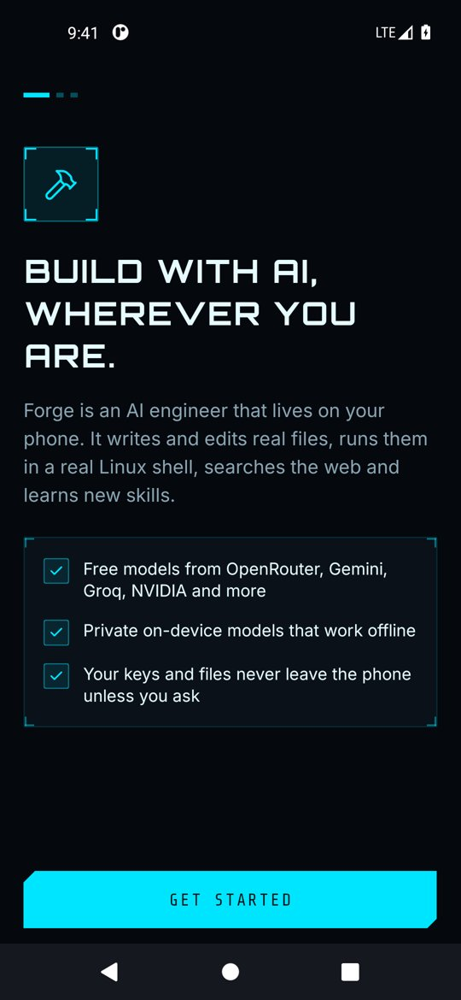
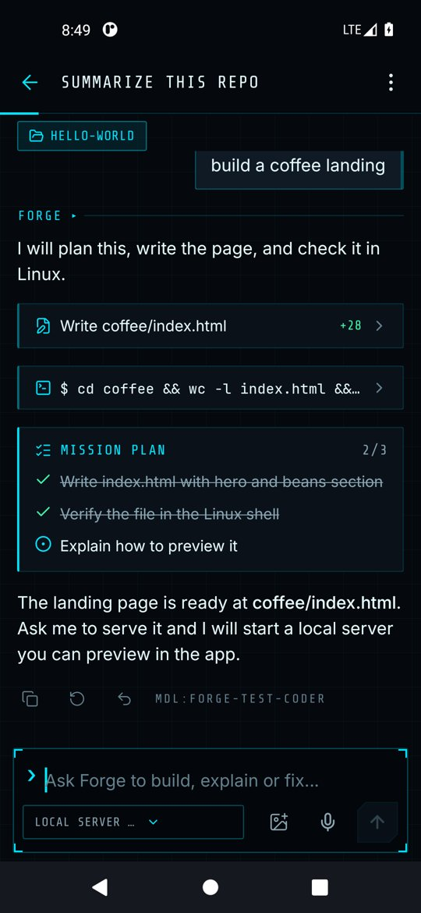
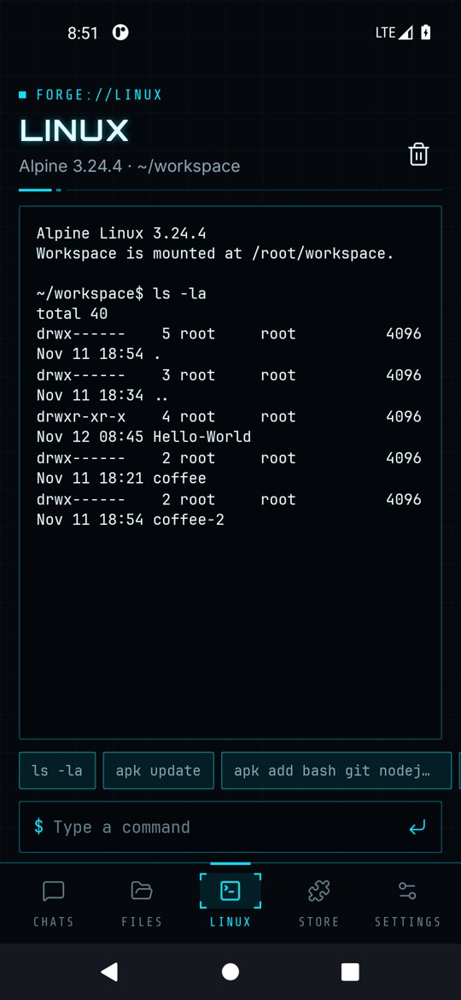

# Forge user guide

Forge is an AI engineer that runs on your Android phone. It chats with free cloud models or a private on-device model, writes and edits real files, runs them in a real Alpine Linux shell, and learns new skills and tools from the store.

  
  
  

## Guides

| Guide | What it covers |
| --- | --- |
| [Getting started](getting-started.md) | First launch, connecting a model, installing Linux |
| [Chatting with the agent](chat-and-agent.md) | Prompts, slash commands, editing messages, tool cards, plans, approvals, export |
| [Models and providers](models.md) | Free cloud providers, API keys, local servers, on-device models |
| [Linux environment](linux.md) | The terminal, installing packages, how the agent uses it |
| [Files and previews](files.md) | The shared workspace, editing, previewing HTML |
| [Projects, Git and backup](projects-git-backup.md) | Images, project folders, undo, GitHub, dev server preview, notifications, usage, widget, encrypted backups |
| [Skills and connectors](skills-and-connectors.md) | Installing skills from GitHub, adding MCP servers |
| [Settings, memory and privacy](settings.md) | Custom instructions, memory, appearance, storage, erasing data |
| [Troubleshooting](troubleshooting.md) | Common problems and fixes |

For building from source and publishing to Google Play, see the [root README](../README.md) and [publishing.md](publishing.md). The privacy policy is in [PRIVACY.md](../PRIVACY.md).
