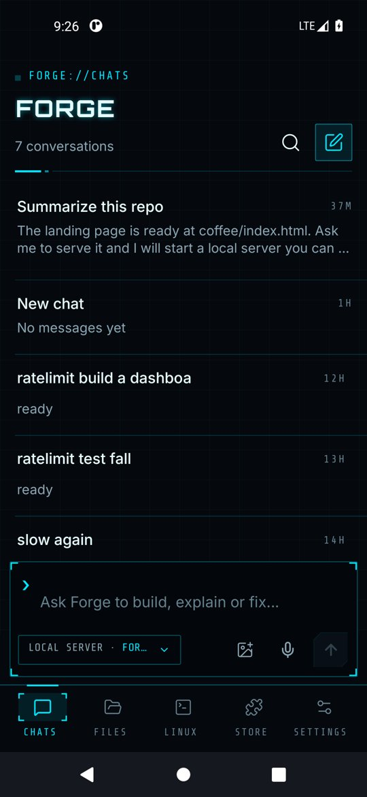
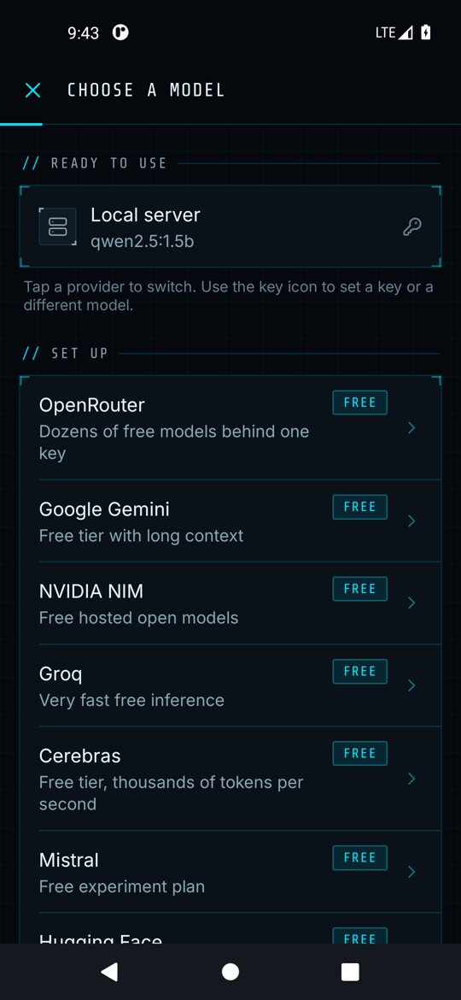
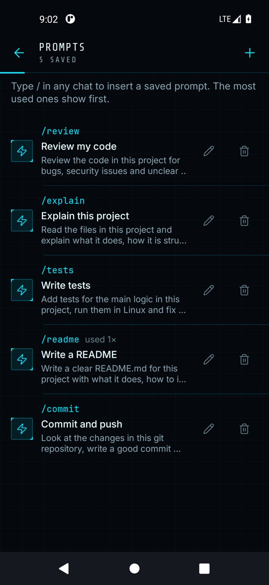
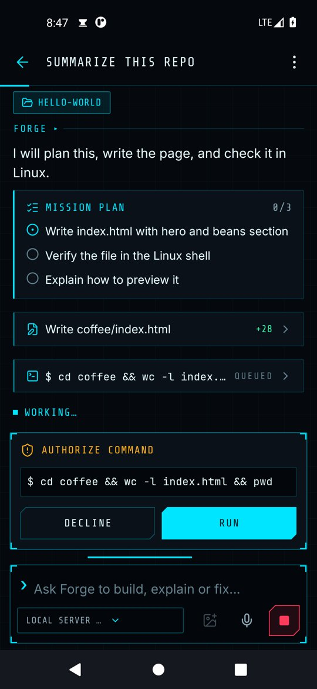
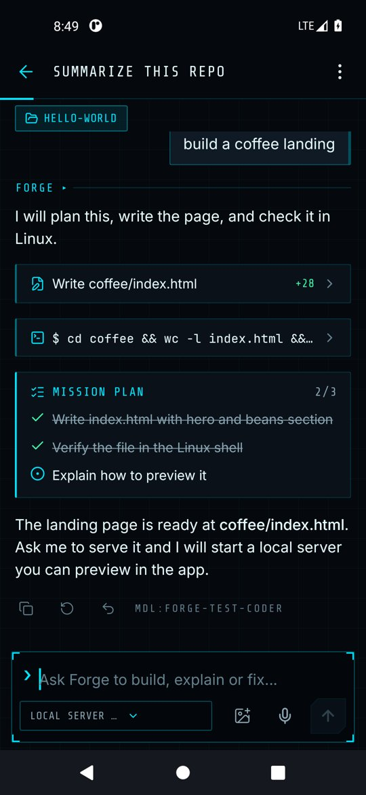
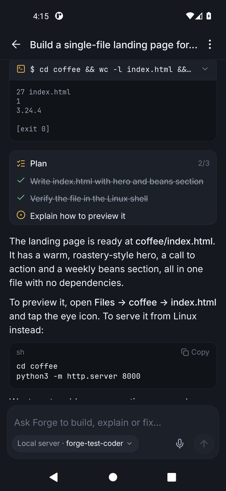

# Chatting with the agent

Forge is more than a chat box. When you ask it to build something it plans the work, writes files in your workspace, runs commands in Linux and reports back.

## Starting a chat

From **Chats**, tap the pencil icon or a starter card. The composer at the bottom shows the active provider and model; tap the chip to switch models for this chat.

  
  

Good requests say what you want and where it should end up, for example:

> Build a single-file landing page for a neighborhood coffee roaster in coffee/index.html, then tell me how to preview it.

You can also dictate with the microphone button, or share text from any app to Forge with Android's share sheet.

## Saved prompts and slash commands

Type `/` at the start of the message box to see your saved prompts, then tap one to insert it and edit before sending. Forge ships with `/review`, `/explain`, `/tests`, `/readme` and `/commit`. Add your own in **Settings → Saved prompts**; the prompts you use most appear first.

## Editing a message

Long-press a message you sent and choose **Edit and resend**. The message box fills with the text and turns gold; when you send, the answers after that message are replaced by a new run.

## What you see while it works

  
  
  

- **Plan card.** For multi-step work the agent writes a short checklist and ticks items off. Only the latest plan is shown.
- **Tool cards.** Each action is a card: *Write coffee/index.html +28* for a file change, *$ command* for a shell command, a globe for a web page, a book for a skill it loaded. Tap a card to see the diff or output. A card says *waiting* while it needs your approval and *running* while it executes.
- **Approval card.** When your permission mode requires it, Forge stops and asks **Run this command?** or **Allow this change?** with the exact command or file. Tap **Run**/**Allow** or **Decline**.
- **Answer.** The final reply supports Markdown, tables and code blocks with a **Copy** button. Under each answer you can copy, regenerate or see which model replied.

Tap the stop button in the composer at any time to halt the agent.

## Permission modes

Set in **Settings → Agent permissions**.

| Mode | File changes | Shell commands |
| --- | --- | --- |
| Ask first | Ask every time | Ask every time |
| Auto edits (default) | Automatic | Ask every time |
| Full auto | Automatic | Automatic |

File tools can only touch the workspace. Commands run inside the Linux sandbox, not on Android itself.

## Tools the agent can use

| Tool | What it does |
| --- | --- |
| `list_files`, `read_file` | Look around the workspace |
| `write_file`, `edit_file`, `delete_path` | Create and change files (with a diff) |
| `run_command` | Run a shell command in Alpine Linux, in the workspace folder |
| `web_search`, `web_fetch` | Search DuckDuckGo and read web pages (can be turned off) |
| `remember`, `recall` | Long-term memory across chats (can be turned off) |
| `load_skill` | Pull in an installed skill's instructions when a task matches |
| `update_plan` | Show and update the plan card |
| Connector tools | Any tool from an enabled MCP connector |

## Managing chats

Long-press a chat in the list to pin it to the top or delete it. Use the search field to find old conversations. The menu in a chat's header lets you export the chat as a Markdown file (with the tools each step used), share the transcript, set a project folder or delete the chat.

Next: [Models and providers](models.md).
