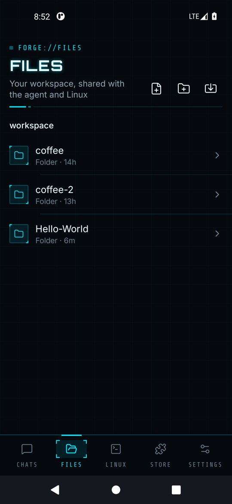
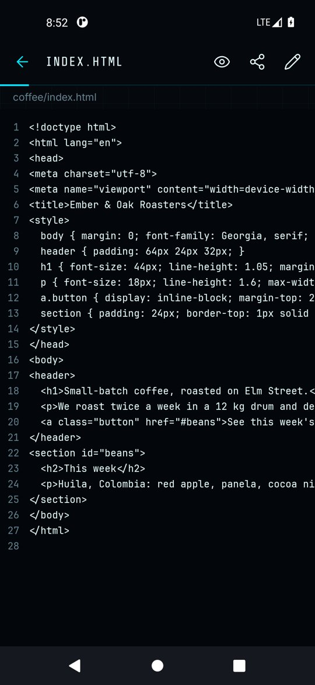
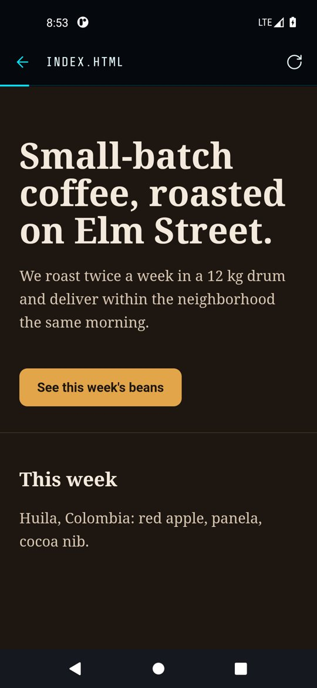

# Files and previews

The **Files** tab shows the workspace: the folder shared by you, the agent and Linux (`/root/workspace`).

  
  
  

- Tap a folder to open it, and tap a name in the path bar above the list to jump back up. Use the icons at the top to create a file or folder.
- Tap a file to view it with line numbers. Markdown files render formatted.
- The pencil icon switches to edit mode; the save icon writes the file.
- The share icon sends the file's text to another app.
- For `.html` files the eye icon opens a live **Preview** in a built-in browser, so you can see pages the agent built without a server.
- Long-press an item to delete it.

Everything lives in app-private storage and is excluded from Android cloud backup. **Settings → Storage** shows how much space the workspace uses.
