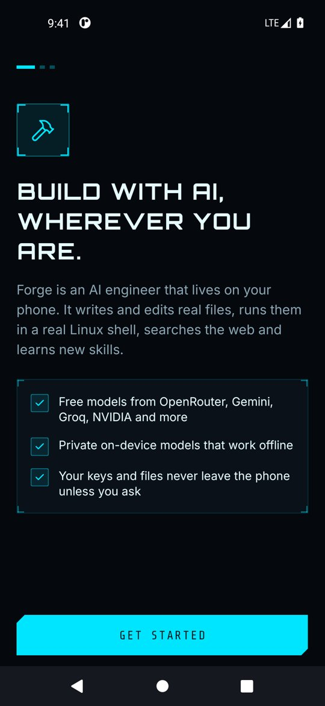
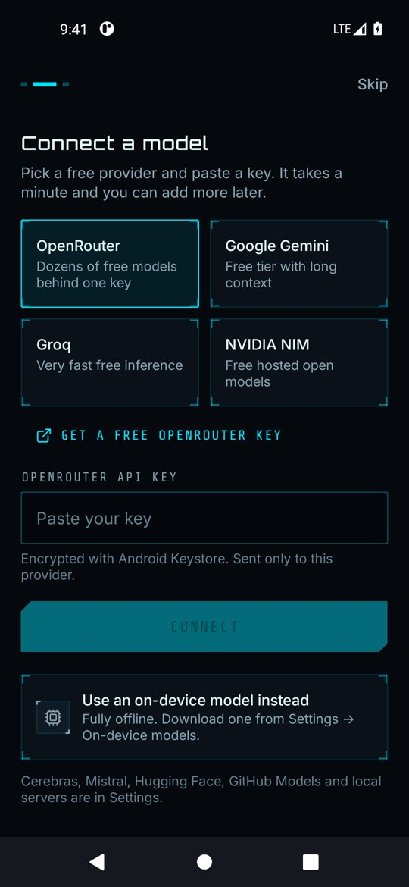
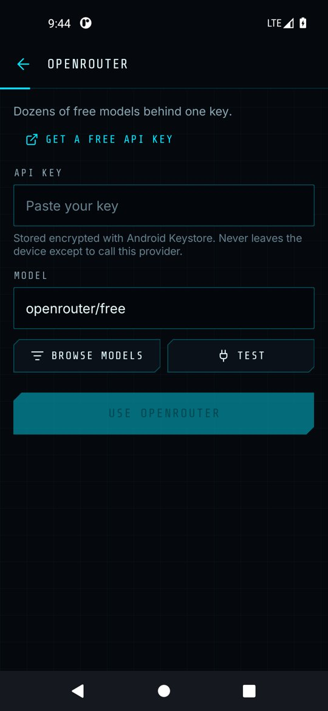
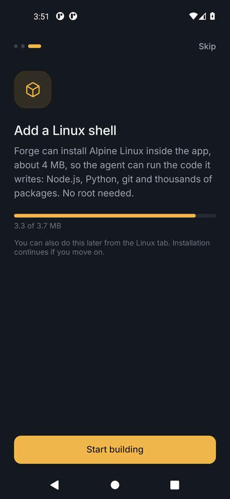
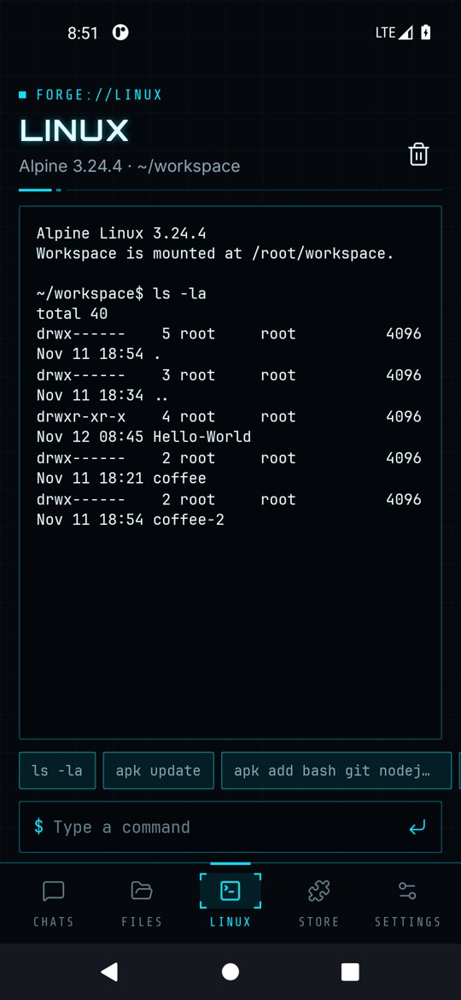
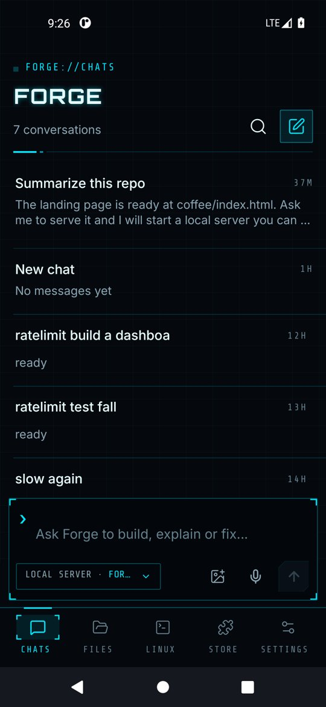

# Getting started

Setup takes three short steps and you can skip any of them and come back later from Settings.

## 1. Welcome

The first screen explains what Forge does. Tap **Get started**.

  

## 2. Connect a model

Pick where answers come from. Every option on this screen has a free tier.

- **OpenRouter** is the easiest start: one free key gives you dozens of free models, and the default `openrouter/free` router picks an available one for you.
- **Google Gemini**, **Groq**, **NVIDIA NIM**, **Cerebras**, **Mistral**, **Hugging Face** and **GitHub Models** each need their own free key.
- **On this phone** runs a downloaded model with no internet and no key (see [Models](models.md#on-device-models)).
- **Local server** talks to Ollama, LM Studio or llama.cpp running on the phone or your network.

Tap a provider, then **Get a free API key** to open its key page in the browser. Paste the key, tap **Test** and you should see *ready*.

  
  

Keys are encrypted with Android Keystore and only ever sent to the provider they belong to.

## 3. Install Linux (recommended)

Forge can download the official Alpine Linux root filesystem (about 4 MB), verify its SHA-256 checksum and run it with PRoot. No root access is needed. With Linux installed the agent can actually run what it writes: Node.js, Python, git and thousands of packages.

  
  

When it says **Alpine Linux is ready**, tap **Start building**.

## What next

You land on **Chats**. Tap one of the starter cards or type your own request.

  

Continue with [Chatting with the agent](chat-and-agent.md).
