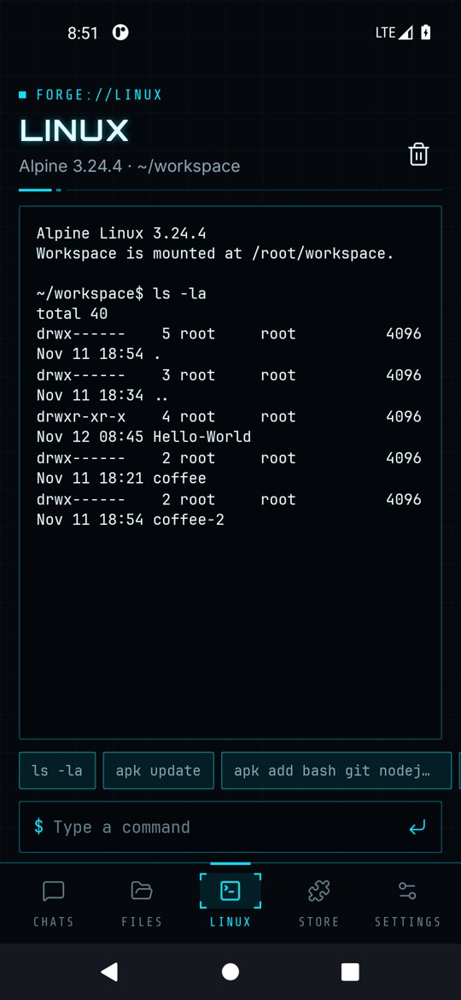

# Linux environment

Forge includes a real Alpine Linux userland running under PRoot, the same approach Termux uses. It runs inside the app's private storage, needs no root and cannot touch the rest of your phone.

<p>
  
  
</p>

## Installing

Install it during onboarding or from the **Linux** tab. Forge downloads the latest stable Alpine minirootfs for your CPU (arm64 or x86_64), checks its SHA-256, unpacks it and runs a self-test. The base system uses about 50 MB.

## Using the terminal

The **Linux** tab is a shell in `/root/workspace`, which is the same folder you see in **Files**.

- Type a command and tap the return button. Tap stop to cancel a long command.
- `cd` is remembered between commands; the current folder is shown under the title.
- Quick chips run common commands: `ls -la`, `apk update`, `node -v`, `python3 --version`, `df -h /` and more.
- One chip installs a full dev toolset in one tap: `apk add bash git nodejs npm python3 py3-pip curl openssh-client build-base`.

Install anything else with `apk add <package>`, for example:

```sh
apk update
apk add python3 nodejs npm git
pip install requests --break-system-packages
```

## How the agent uses it

The `run_command` tool runs commands in the same environment, starting in the workspace. So the agent can `npm install`, run tests, start a script or check its own output. Your permission mode decides whether it asks first.

## Limits

- Commands run without a terminal emulator, so interactive full-screen programs (vim, top) do not work; use non-interactive flags.
- Long-running servers stop when Android suspends the app. Use the HTML preview in Files for static sites.
- PRoot is slower than native Linux for heavy builds.

## Removing it

**Settings → Linux environment → Remove Linux environment** deletes the system. Your workspace files are kept.
