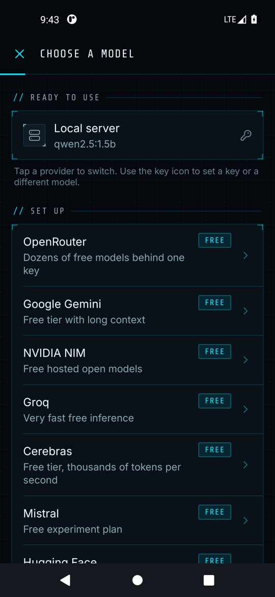
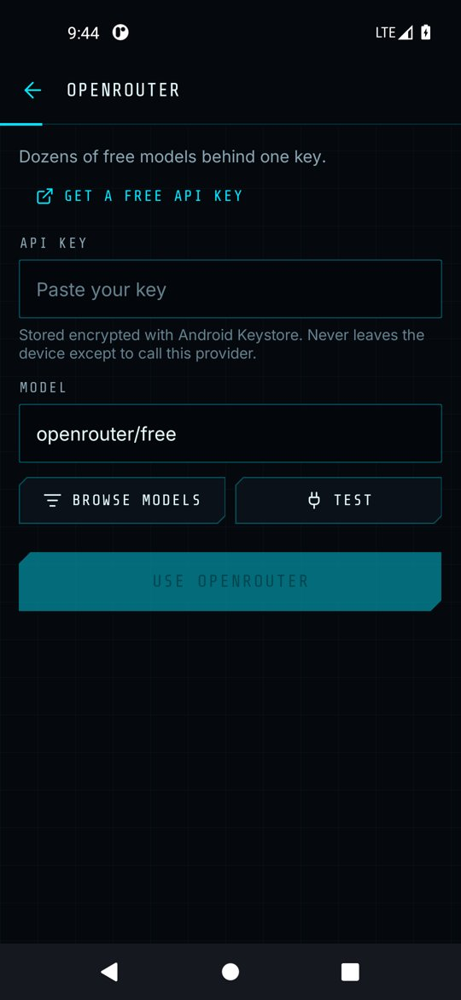
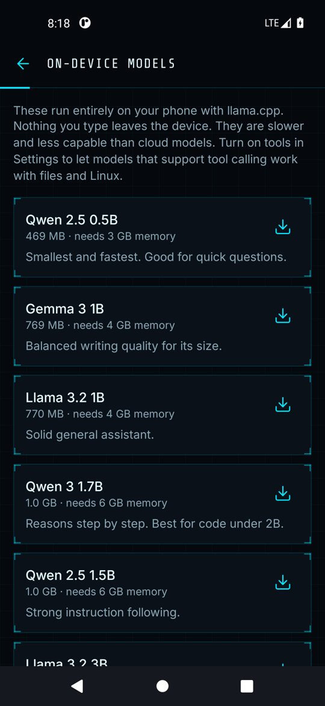

# Models and providers

Forge works with any OpenAI-compatible API, plus models that run directly on the phone.

## Choosing the active model

Tap the model chip in the composer, or **Settings → Active model**. The picker lists every provider; providers without a key show **Add key**. Inside a provider tap **Browse models** to fetch its live catalog, then pick one.

  
  

## Free cloud providers

| Provider | Default model | Where to get a key |
| --- | --- | --- |
| OpenRouter | `openrouter/free` | openrouter.ai/settings/keys |
| Google Gemini | `gemini-2.5-flash` | aistudio.google.com/apikey |
| NVIDIA NIM | `meta/llama-3.3-70b-instruct` | build.nvidia.com |
| Groq | `llama-3.3-70b-versatile` | console.groq.com/keys |
| Cerebras | `gpt-oss-120b` | cloud.cerebras.ai |
| Mistral | `mistral-small-latest` | console.mistral.ai/api-keys |
| Hugging Face | `openai/gpt-oss-120b` | huggingface.co/settings/tokens |
| GitHub Models | `openai/gpt-4.1-mini` | github.com/settings/personal-access-tokens |

Free tiers have rate limits that the providers change over time. If you see *429* or *rate limit* errors, wait a minute or switch provider. Models need **tool calling** support for agent work; most large instruct models have it.

**Custom endpoint** accepts any HTTPS OpenAI-compatible base URL and key. **Local server** points at Ollama (`http://127.0.0.1:11434/v1`), LM Studio or llama.cpp; plain HTTP is only allowed to localhost.

## On-device models

**Settings → On-device models** lists small models that run fully offline with llama.cpp. Nothing you type leaves the phone.

  

- Forge shows your phone's memory and free storage and warns when a model is likely too big.
- Downloads resume if interrupted, are checksum-verified, and can be cancelled or deleted.
- You can paste any GGUF link from Hugging Face.
- On-device models are slower and do not use tools, so they are best for questions and drafting, not agent tasks.

As a rule of thumb: 3 GB of RAM handles the 0.5B models, 4 GB handles 1B, and 6 GB or more is needed for 1.5B to 4B.
