# Projects, Git and backup

Forge 4.1 adds the pieces you need to work on real projects from your phone.

## Typing without losing the chat

The message box, onboarding fields and every form stay above the keyboard, and the tab bar hides while you type.

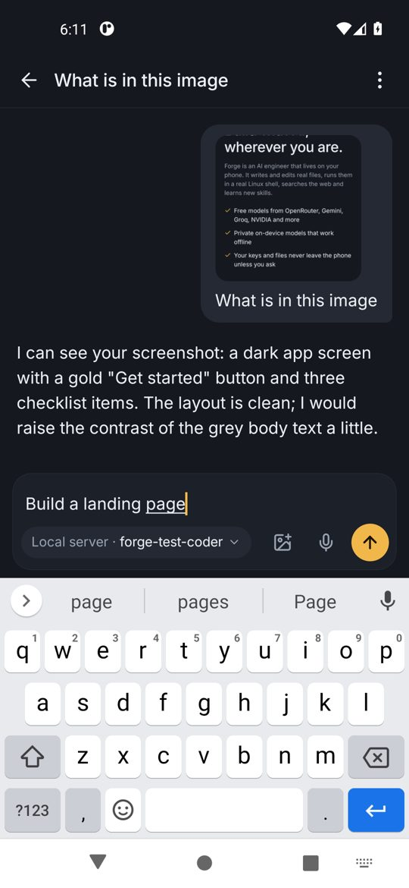

## Images

Tap the image button in the composer to attach a photo or screenshot. Forge resizes it on the phone and shows it in the conversation. Use a vision model (for example Gemini, or a vision model on OpenRouter); if the model cannot read images, Forge tells you to switch.

  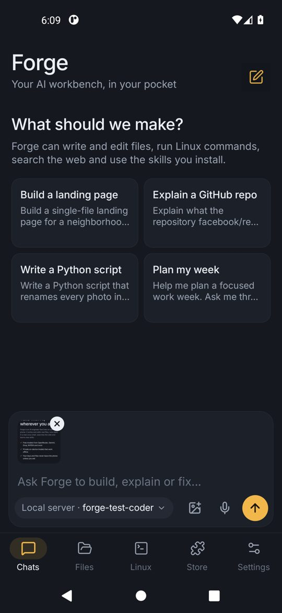
  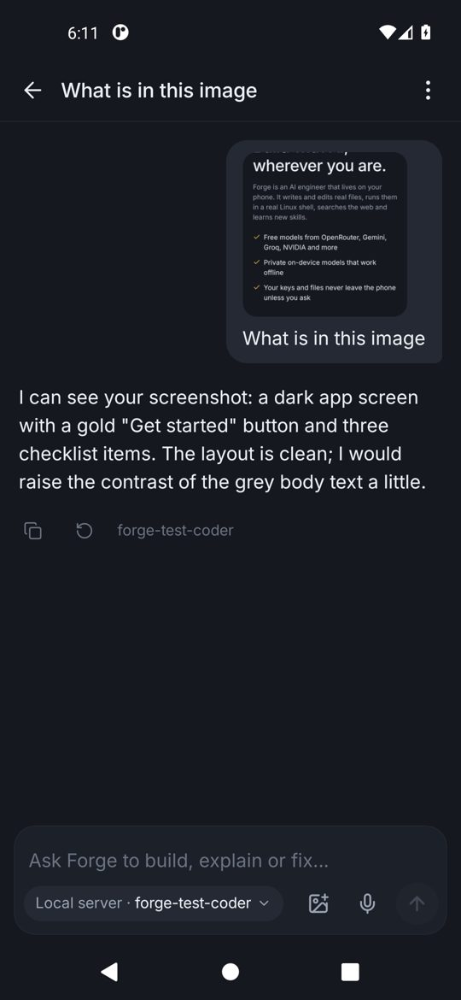

## Project folders

Open the chat menu and choose **Set project folder**. The agent then reads, writes and runs commands only inside that folder, so each project stays separate. The folder shows as a chip at the top of the chat. Create a new folder from the same screen.

In **Files**, long-press a folder and choose **Export as zip** to save it anywhere on your phone (`node_modules` folders are skipped). The import button in the Files header unpacks a zip into the workspace.

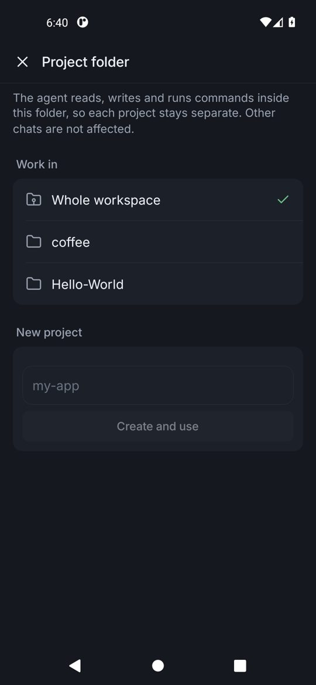

## Undo file changes

Every request records the files it changes. Tap the undo arrow under the reply to restore them, including deleting files the agent created. Undoing an earlier request also undoes the requests after it. Commands run in Linux are not undone.

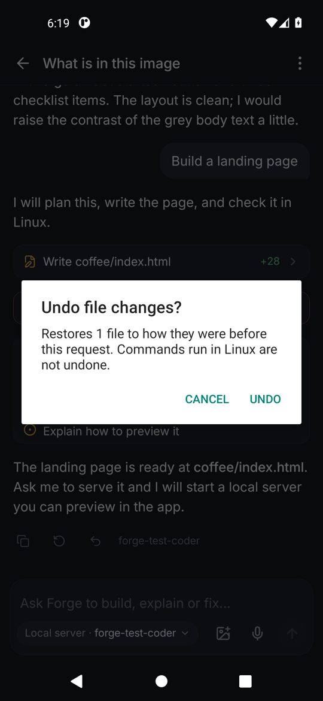

## Dev servers and live preview

Ask the agent to serve your project. It uses the `start_server` tool, and the server keeps running in the background. The **Linux** tab lists running processes with their port. Tap the globe to open the preview, or the square to stop it. In the terminal, end any command with `&` to run it in the background.

  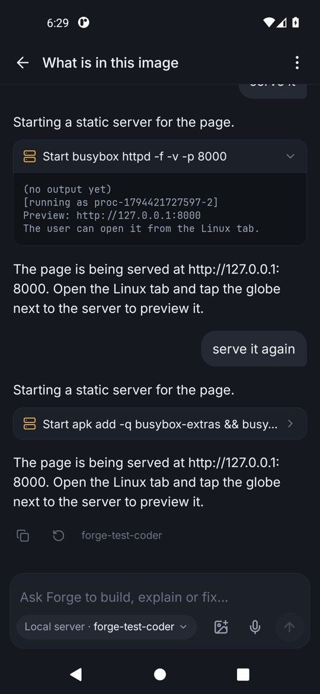
  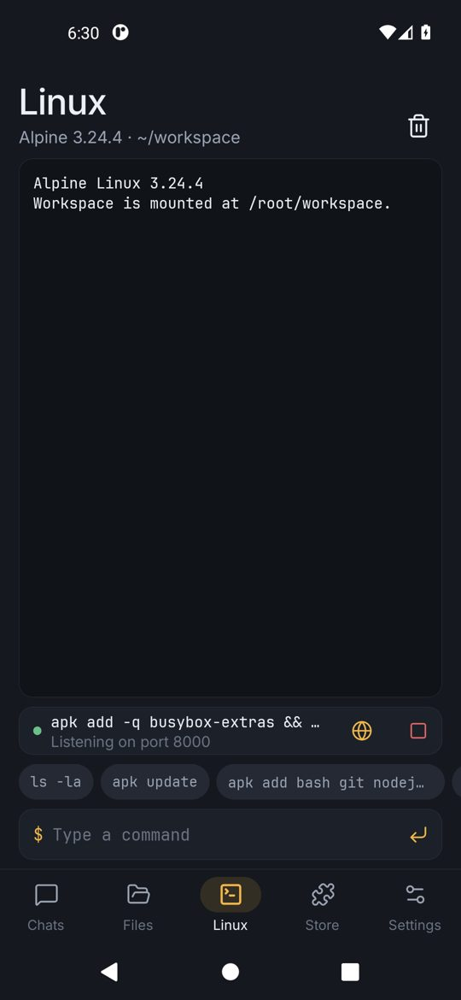
  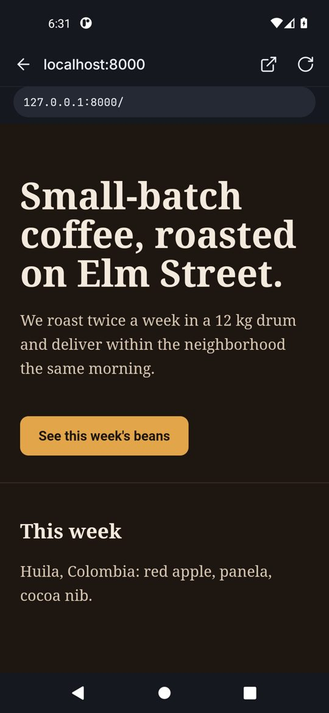

Alpine's default busybox has no web server. For static sites use `apk add busybox-extras && busybox-extras httpd -f -p 8000`, `python3 -m http.server`, or `npx serve`.

## Git and GitHub

**Settings → Linux environment → Git and GitHub.**

1. Tap **Create a token** and make a fine-grained token with *Contents: read and write* for the repositories you want. To create new repositories from Forge, also allow *Administration: read and write*.
2. Paste it and tap **Connect**. Forge checks it with GitHub and shows your login.
3. Set the name and email used for commits.
4. Paste a repository URL and tap **Clone into workspace**, or ask the agent to clone, commit and push.

The token is stored encrypted and written to git's credential file inside the Linux environment. **Disconnect** removes it.

  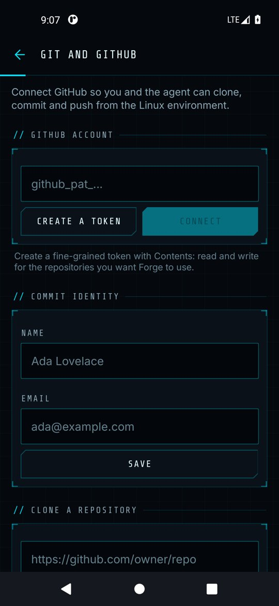
  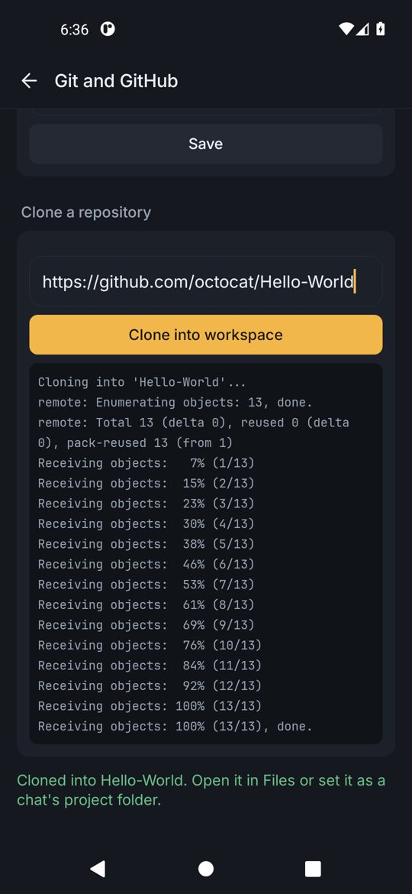

### Push a project to GitHub

**Git and GitHub → Push to GitHub**, or long-press a folder in **Files** and choose **Push to GitHub**.

1. Tap **Import a zip** to unpack your source code into the workspace, or pick a folder that is already there. If the zip holds a single top-level folder, Forge uses that folder as the project root.
2. Forge reads the file tree, manifests (package.json, build.gradle, pyproject.toml and others) and the README, and asks your current model for a repository name, a one-sentence description and up to ten topics. If the project has no `.gitignore`, the model writes one for its stack. Secret-looking files (`.env`, keystores, `google-services.json`, private keys) and dependency or build folders are always added to it. If no model is available, Forge fills everything in from the project files and a template instead.
3. Edit anything you like, choose **Private** or **Public**, and tap **Create repository and push**. Forge creates the repository on your account, saves the topics, makes the first commit and pushes it.

Creating repositories needs a token that allows it: a fine-grained token with *Administration* and *Contents* set to read and write for all repositories, or a classic token with the *repo* scope. If the project already has an `origin` remote, the new repository is added as a remote called `github`.

## Finish notifications

If you leave Forge while the agent works, a notification arrives when the task finishes. Tap it to open the chat. Turn it off in **Settings → Agent permissions → Notify when a task finishes**.

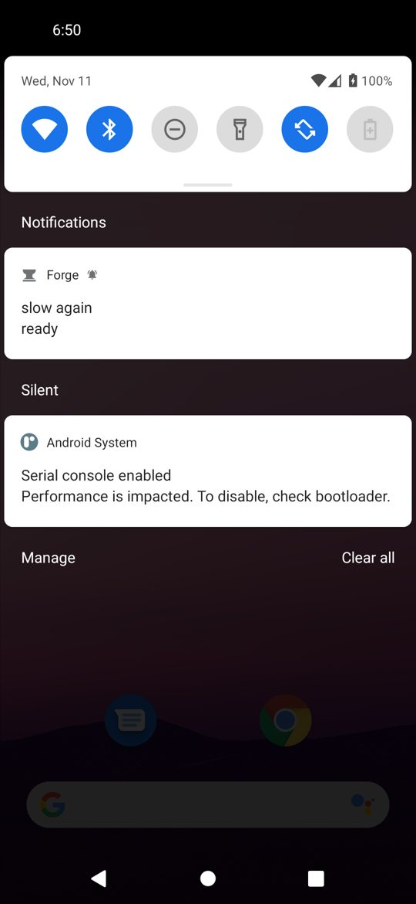

## Tools for on-device models

On-device models that support tool calling (Qwen 2.5 and 3 work well) can read and write files and run Linux commands. Turn this off in **Settings → Models → Let on-device models use tools** if a model gets confused.

## Usage

**Settings → Usage and limits** opens the dashboard. The top card shows today's tokens, the change from yesterday and, if you set one, a ring against your daily budget. Below it are requests, success rate, tokens in and average response time for the chosen range (today, 7 or 30 days), a stacked chart of tokens in and out per day (tap a bar for exact numbers, or see requests by hour for today), a heatmap of when you used Forge over the last week, a provider donut and your top models. Counts come from the provider when it reports them and are estimated otherwise.

### Daily budget and fallback

Under **Limits** pick a daily token budget (50k, 200k or 1M). Forge sends one notification when today goes over and shows a banner above the message box. **Switch provider on rate limits** retries a step with another provider that has a key when the current one returns 429 or is down; the chat shows a small note saying which provider took over.

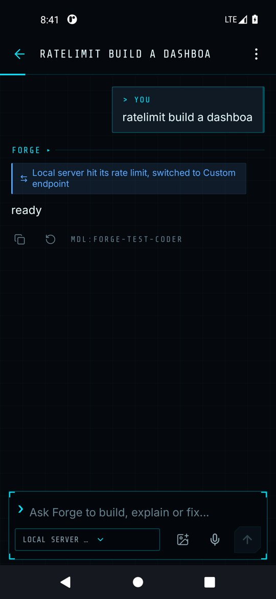

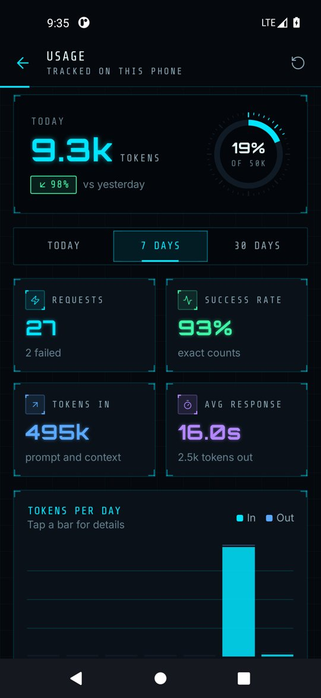

## Widget, tile and shortcuts

- **Widget:** long-press your home screen, choose Widgets, and add Forge's **New chat** widget.
- **Quick settings tile:** edit your quick settings and drag **Forge chat** into place.
- **App shortcuts:** long-press the Forge icon.

## Encrypted backup

**Settings → Storage → Backup and restore.**

- **Create:** enter a password twice, choose whether to include API keys and tokens, and tap **Save backup file**. The file is encrypted with AES-256-GCM and a key derived from your password.
- **Restore:** enter the password, pick the file and confirm. Restoring replaces the chats, memory and settings on this phone.

Workspace files are not part of the backup; export project folders as zips. Forge cannot recover a forgotten password.

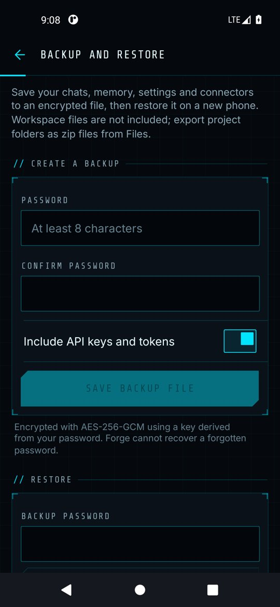
