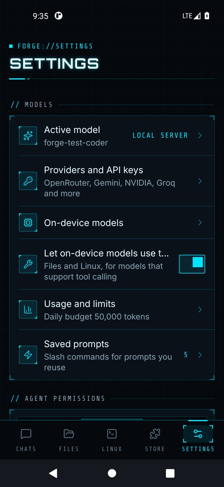
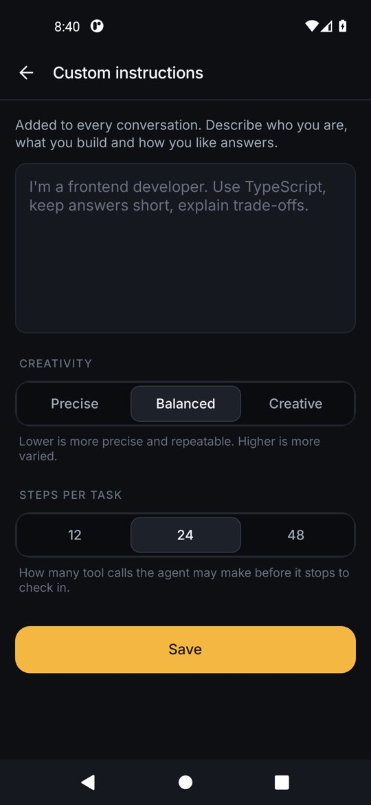
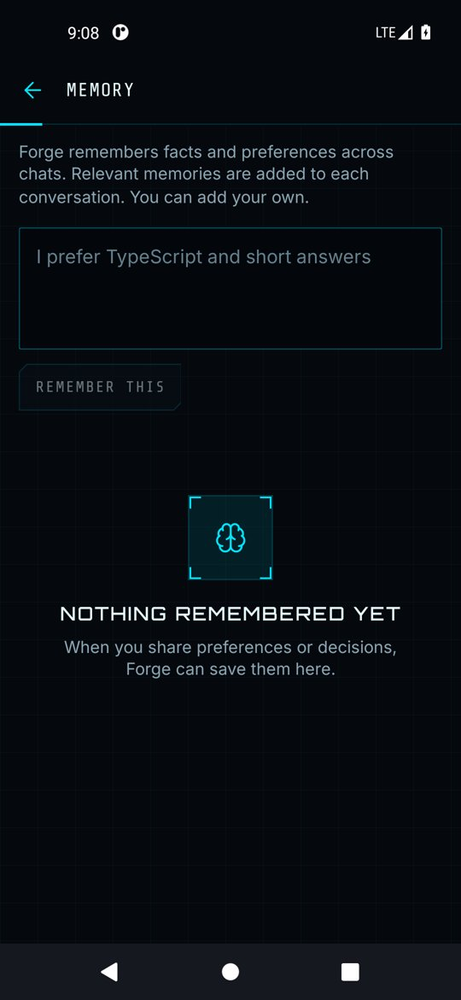

# Settings, memory and privacy

  
  
  

## Models
Active model, providers and API keys, and on-device models. See [Models](models.md).

## Agent permissions
Choose **Ask first**, **Auto edits** or **Full auto** (see [permission modes](chat-and-agent.md#permission-modes)), and turn **Web search and browsing** or **Long-term memory** on or off.

## Personalization
- **Custom instructions** are added to every conversation. Describe who you are and how you like answers. **Creativity** sets the sampling temperature (Precise, Balanced, Creative). **Steps per task** caps how many tool calls the agent makes before checking in (12, 24 or 48).
- **Memory** lists facts the agent saved with the `remember` tool. Add your own, or delete any entry. Relevant memories are included in new chats.

## Appearance
System, Dark or Light theme.

## Linux environment
Shows the installed Alpine version and disk use, and lets you remove it.

## Storage
Workspace size, downloaded model size and free space. **Delete all chats** clears conversations; **Erase all data** removes chats, keys, memory, skills, connectors, models, files and Linux.

## About
Version, privacy policy, terms of use and open-source licenses. The full policy is also in [PRIVACY.md](../PRIVACY.md).
