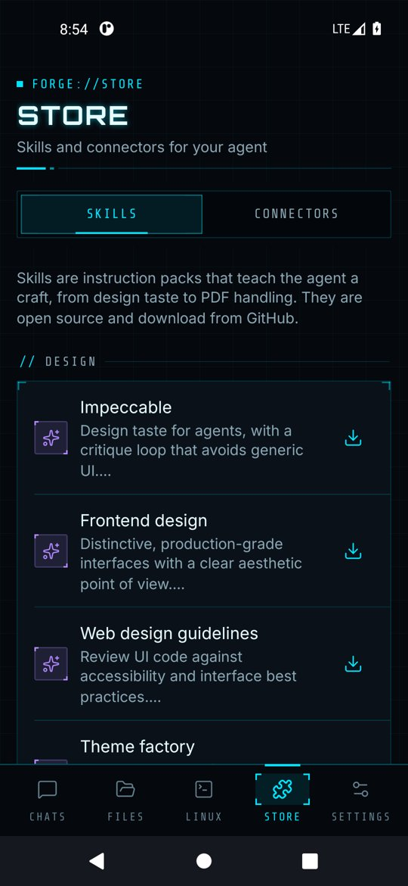
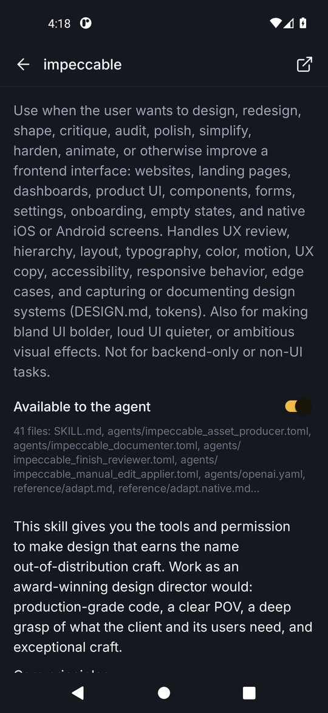
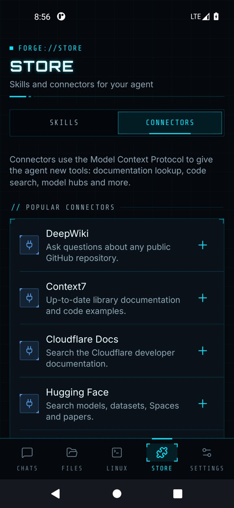
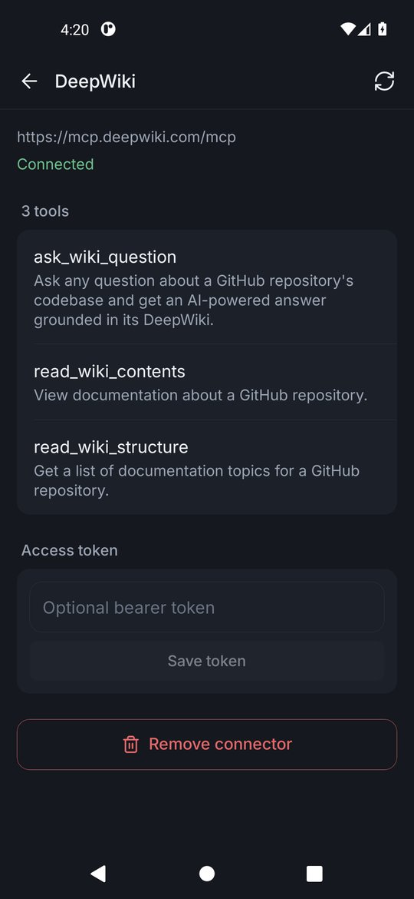

# Skills and connectors

The **Store** tab extends what the agent knows (skills) and what it can do (connectors).

## Skills

Skills are open-source instruction packs: a `SKILL.md` plus reference files that teach the agent a craft such as design taste, debugging discipline or PDF handling.

  
  

- Browse the curated catalog by category (Design, Engineering, Documents, Workflow) and tap the download icon to install. Skills download straight from GitHub.
- Or tap **Install from GitHub** and paste any GitHub link to a folder with a `SKILL.md`, for example `https://github.com/pbakaus/impeccable`.
- Installed skills appear at the top with a switch. Enabled skills are offered to the agent, which loads one only when a task matches, so they do not slow down normal chats.
- Tap a skill to read its instructions, see its files, open it on GitHub or remove it.

## Connectors (MCP)

Connectors use the Model Context Protocol (Streamable HTTP) to give the agent new tools.

  
  

- Add one from **Popular connectors** (DeepWiki, Context7, Cloudflare Docs, Hugging Face, Exa Search and more) or tap **Add a custom connector** for any MCP server URL.
- Forge connects, lists the server's tools and shows **Connected**. The switch enables or disables the connector for all chats.
- Servers that need authentication accept a bearer token on the detail screen; it is stored encrypted.
- Use the refresh icon to reconnect, and **Remove connector** to delete it.

Only add connectors you trust: the agent sends tool arguments, which can include parts of your conversation, to that server.
